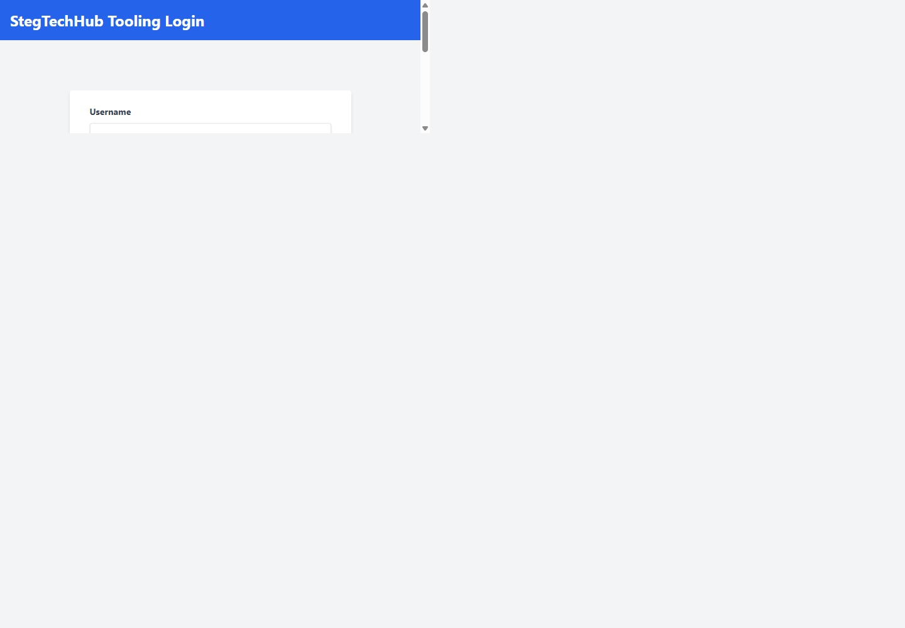
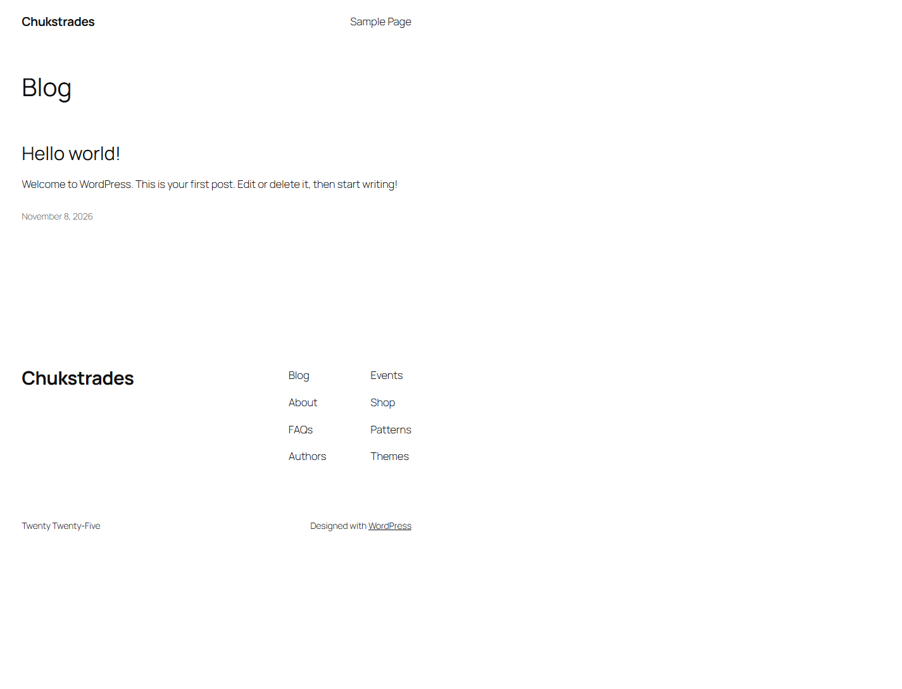
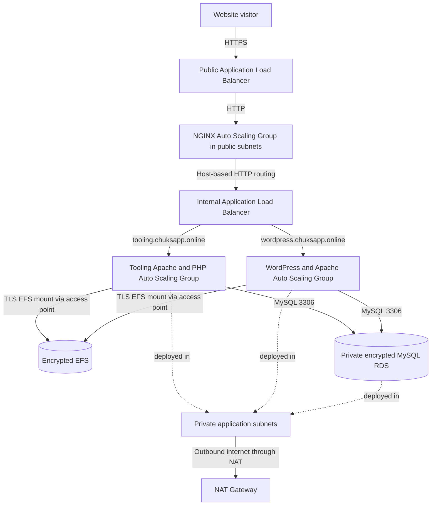

# AUTOMATE-INFRASTRUCTURE-USING-IaC-TERRAFORM-PART-02

This repository provisions the AWS infrastructure for the StegTechHub Tooling PHP application and the Chukstrades WordPress website. Terraform builds the network and managed services, while EC2 user-data scripts install the web stacks and connect them to shared EFS storage and a private MySQL database.

## Live websites

| Service | URL | Verified page |
| --- | --- | --- |
| Tooling PHP application | [https://tooling.chuksapp.online](https://tooling.chuksapp.online) | StegTechHub Tooling Login |
| WordPress | [https://wordpress.chuksapp.online](https://wordpress.chuksapp.online) | Chukstrades homepage |

Both sites were checked over HTTPS after deployment. The Tooling site serves its PHP login page, and WordPress serves its configured homepage.

## Screenshot evidence

The following screenshots were captured from the live websites and are included in this repository:

### StegTechHub Tooling



Live page: [tooling.chuksapp.online](https://tooling.chuksapp.online)

### Chukstrades WordPress



Live page: [wordpress.chuksapp.online](https://wordpress.chuksapp.online)

## AWS Console evidence

These point-in-time screenshots were captured from the AWS Management Console in `us-east-1`. They show the deployed networking, compute, load-balancing, storage, database, and encryption resources.

| Evidence | What it shows |
| --- | --- |
| [VPC overview](images/pbl/vpc.png) and [VPC topology](images/pbl/vpc-02.png) | `chuks_vpc`, its subnets, route tables, and network connections |
| [Security groups](images/pbl/Security_groups.png) | Security groups configured in the VPC |
| [Auto Scaling Groups](images/pbl/ASG.png) | Four groups at desired capacity with healthy instances |
| [EC2 instances](images/pbl/INSTANCES.png) | Running instances and EC2 status checks |
| [Load balancers](images/pbl/load-balancer.png) | Active public and internal Application Load Balancers |
| [External target group](images/pbl/ext-target-group.png), [Tooling target group](images/pbl/tooling-tg.png), and [WordPress target group](images/pbl/wordpress-tg.png) | Target registration and health for each application tier |
| [RDS database](images/pbl/rds.png) | MySQL database instance status |
| [EFS file system](images/pbl/efs.png) | File system availability and encryption status |
| [KMS key](images/pbl/kms.png) | Customer-managed key alias, enabled status, and key usage |

These screenshots complement the Terraform configuration; they are not a complete export of every AWS resource or a replacement for Terraform state and plan review.

## Architecture



### Request flow

1. Route 53 aliases both site names to the public Application Load Balancer.
2. The public ALB terminates HTTPS using the ACM certificate. HTTP requests are redirected to HTTPS.
3. The public ALB forwards requests to the NGINX Auto Scaling Group.
4. NGINX proxies requests to the internal ALB and preserves the original host and HTTPS-forwarding information.
5. The internal ALB selects the Tooling or WordPress target group based on the request's `Host` header.
6. Private application instances serve the sites and connect to their EFS access points and the private RDS database.

The web instances live in private subnets. A NAT Gateway provides outbound access for package installation and application downloads during instance bootstrapping. The bastion host, when needed, is restricted to the configured SSH source CIDR.

## AWS resources

| Area | Resources and purpose |
| --- | --- |
| Networking | VPC, public and private subnets across Availability Zones, Internet Gateway, route tables, and NAT Gateway |
| Load balancing | Internet-facing HTTPS ALB, internal ALB, host-based routing rules, and `/healthstatus` target health checks |
| Web tiers | NGINX, Tooling, WordPress, and bastion Auto Scaling Groups and launch templates |
| Shared files | Encrypted EFS file system with separate `/tooling` and `/wordpress` access points, each mapping access to UID/GID 33 |
| Database | Private, non-public MySQL 8.0 RDS instance on encrypted storage |
| DNS and TLS | Route 53 aliases and DNS validation for the ACM certificate covering `chuksapp.online` and its subdomains |
| IAM and operations | EC2 instance profile, Systems Manager managed-instance permissions, and an S3-backed Terraform state backend |
| Object storage | Versioned S3 bucket with server-side encryption and public-access blocking |

The current application Auto Scaling Groups are configured for two desired instances each. The Tooling and WordPress applications use the Canonical Ubuntu 22.04 AMI parameter, Apache, and PHP. NGINX and bastion use the configured `ami` variable.

## Repository layout

| File or directory | Purpose |
| --- | --- |
| `main.tf` | VPC, subnets, gateways, routing, S3 bucket, and Ubuntu AMI lookup |
| `asg.tf` | Launch templates, instance profiles, and Auto Scaling Groups |
| `alb.tf` | Public and internal ALBs, listeners, host routing, and health checks |
| `cert.tf` | ACM certificate, DNS validation records, and application aliases |
| `security_group.tf` | Network ingress and egress rules between tiers |
| `efs.tf` | Encrypted EFS file system, mount targets, and per-application access points |
| `rds.tf` | Private MySQL instance and database subnet group |
| `roles.tf` | EC2 IAM role, instance profile, and Systems Manager permissions |
| `kms.tf` | Encryption key and alias used by the deployment |
| `variables.tf` | Region, networking, credentials, AMI, and account variables |
| `outputs.tf` | Website URLs, VPC ID, and subnet details |
| `versions.tf` | Terraform, AWS provider, and remote-state backend requirements |
| `nginx.sh` | NGINX installation and host-based reverse proxy configuration |
| `tooling.sh` | Tooling Apache/PHP, EFS, RDS, and schema bootstrap |
| `wordpress.sh` | WordPress, Apache, EFS, and RDS bootstrap |
| `bastion.sh` | Bastion host bootstrap |
| `images/pbl/` | Live website screenshots and AWS Console evidence |

## Requirements

- An AWS account with permissions to manage the resources declared in the Terraform configuration.
- AWS credentials configured locally, such as with an AWS CLI profile or the standard AWS credential environment.
- Terraform `~> 1.14.0`.
- AWS provider `~> 6.0` (downloaded by Terraform initialization).
- AWS CLI for optional live health and resource checks.
- An EC2 key pair name, database username/password, AMI ID for the NGINX and bastion instances, and AWS account number.
- The Route 53 public hosted zone for `chuksapp.online`.
- The S3 bucket configured as the Terraform backend must already exist before the first `terraform init`. The configuration also declares that bucket as an infrastructure resource, so a first-time deployment into a new account needs a separate backend-bucket bootstrap before initializing this stack.

The variables `preferred_number_of_subnets` and `preferred_number_of_private_subnets` must each provide at least two subnets for the load balancers and database.

## Configure and deploy

Run these commands from the directory containing the `.tf` files.

1. Configure the required Terraform variables using an ignored local variable file or your organization's secret-injection mechanism. The required variables without defaults include `keypair`, `username`, `password`, `ami`, and `account_no`. Set `region` if you are not deploying to `us-east-1`.
2. Initialize the S3 backend and download the AWS provider:

   ```sh
   terraform init
   ```

   The current evidence set does not include an initialization screenshot.

3. Check formatting and configuration:

   ```sh
   terraform fmt -check -recursive
   terraform validate
   ```

   Evidence: [Terraform formatting](images/pbl/fmt.png) and [validation success](images/pbl/validate.png).

4. Review the proposed infrastructure changes:

   ```sh
   terraform plan
   ```

   Evidence: [plan output](images/pbl/plan.png), [continued plan output](images/pbl/plan%20-02.png), and [no-changes plan result](images/pbl/terraform-plan.png).

5. Apply only after reviewing the plan and confirming the account, region, and changes:

   ```sh
   terraform apply
   ```

   Evidence: [apply completion](images/pbl/apply.png).

Terraform creates DNS validation records and waits for ACM certificate validation. Instance bootstrapping then installs EFS utilities, mounts the application's EFS access point, configures the RDS connection, and starts Apache or NGINX. The application Auto Scaling Groups allow up to 45 minutes for capacity during rollouts because new web instances must finish bootstrapping before they pass load-balancer health checks.

Retrieve the public URLs from Terraform after deployment:

```sh
terraform output tooling_url
terraform output wordpress_url
```

## Health checks and verification

Each application target group checks `GET /healthstatus` and expects HTTP `200`. The NGINX public target group uses the same path. This endpoint confirms that the relevant web server is responding; it is not a full database or application transaction test.

Check the public websites:

```sh
curl -I https://tooling.chuksapp.online
curl -I https://wordpress.chuksapp.online
```

Inspect target health and Auto Scaling Group status with AWS CLI:

```sh
aws elbv2 describe-target-groups \
  --query 'TargetGroups[].{Name:TargetGroupName,Path:HealthCheckPath}' \
  --output table

aws autoscaling describe-auto-scaling-groups \
  --auto-scaling-group-names nginx-asg tooling-asg wordpress-asg \
  --query 'AutoScalingGroups[].{Name:AutoScalingGroupName,Desired:DesiredCapacity,Instances:Instances[].{Id:InstanceId,Health:HealthStatus,Lifecycle:LifecycleState}}' \
  --output json

aws rds describe-db-instances \
  --query 'DBInstances[].{Id:DBInstanceIdentifier,Status:DBInstanceStatus,Public:PubliclyAccessible}' \
  --output table

aws efs describe-file-systems \
  --query 'FileSystems[].{Id:FileSystemId,State:LifeCycleState,Encrypted:Encrypted}' \
  --output table
```

On an application instance, bootstrap progress is recorded in `/var/log/user-data.log`. Useful checks include:

```sh
cloud-init status --long
mountpoint /var/www/html
curl -i http://127.0.0.1/healthstatus
systemctl is-active apache2
```

Use Systems Manager Session Manager or Run Command for private application instances. Avoid printing user-data, full Terraform plans/state, or environment variables to shared logs; they may contain database connection material.

## Bootstrap behavior

### Tooling PHP

The Tooling bootstrap installs Apache and PHP packages, installs a pinned AWS EFS utilities release, mounts the `tooling` EFS access point over TLS, and deploys the PHP files without attempting to change EFS-managed file ownership. It waits for RDS, configures the application database connection, imports the repository's schema when the expected users table is absent, configures Apache, validates PHP, and starts the web server.

### WordPress

The WordPress bootstrap installs Apache/PHP, mounts the separate `wordpress` access point over TLS, and installs WordPress if it is not already on EFS. It verifies database connectivity, writes `wp-config.php` once, and configures WordPress to recognize HTTPS when it is behind the NGINX and ALB proxy chain. Its health endpoint and Apache configuration are then installed.

### EFS utility installation

Both PHP application bootstraps build the Debian package for the pinned `aws/efs-utils` release without compiling Rust components. This avoids lengthy source builds on the small application instance type while retaining TLS-enabled EFS mounts.

## Secrets and operational safety

- Never commit `terraform.tfvars`, Terraform state files, generated plans, database credentials, or rendered launch-template user-data.
- Marking a Terraform variable `sensitive` hides some CLI output; it does not encrypt the value in Terraform state or prevent authorized users from reading it.
- The application launch templates receive database connection values as user-data. Base64-encoding a value is not encryption. Restrict access to EC2 launch templates, instance user-data, and Terraform state; consider moving runtime credentials to AWS Secrets Manager or Systems Manager Parameter Store with a least-privilege instance role.
- Keep the RDS database private and restrict its security group to the application security group. Do not expose MySQL to the public internet.
- The bastion SSH rule is limited to the source CIDR configured in `security_group.tf`; update that value through a reviewed change if the administrative IP changes.
- Confirm the target AWS account and region before running `terraform apply` or `terraform destroy`. Destroying this stack may remove production resources and data.

## Troubleshooting

| Symptom | Checks |
| --- | --- |
| A public URL shows the Apache default page | Check the NGINX and internal target groups, confirm the `Host` header rules and application health, and inspect `/var/log/user-data.log` on the app instances. |
| An application target is unhealthy | Verify `GET /healthstatus` returns HTTP `200`, Apache is active, and cloud-init completed. Inspect the target group's health-check reason and user-data log. |
| EFS mount fails | Verify EFS mount targets are available in the private subnet Availability Zones, TCP 2049 is allowed from the app security group, and the correct access-point ID and file-system ID are supplied. |
| Files deploy but are not writable | Confirm the instance mounts the correct access point and that the access point enforces UID/GID 33. Do not use `rsync` owner/group preservation on the access point. |
| PHP or WordPress cannot connect to RDS | Confirm RDS is `available`, the database is private, TCP 3306 is allowed from the app security group, and the configured credentials/database name are correct. |
| A new instance takes time to become healthy | User-data installs packages and application files before writing the health endpoint. Check cloud-init and `/var/log/user-data.log` rather than immediately terminating the instance. |
| HTTPS works but WordPress redirects to HTTP | Check the `X-Original-Forwarded-Proto` header on the NGINX proxy path and the HTTPS detection in the shared `wp-config.php`. |
| `terraform init` cannot access the backend | Verify the backend S3 bucket exists, the selected AWS identity can access it, and the configured region is correct. |

## Current deployment evidence

The images in `images/pbl/` include live website captures and point-in-time AWS Console evidence. The console screenshots show the Auto Scaling Groups at desired capacity, running EC2 instances, active load balancers, healthy targets, an available RDS database, and an available encrypted EFS file system. These observations describe the state shown when the screenshots were captured and can change over time.
